# De Slimste Mens

Een quiz-applicatie voor één tot drie spelers, geïnspireerd op *De Slimste Mens* en *De Slimste Mens ter Wereld*. De host bedient het spel via het dashboard; het aparte display toont de quiz voor spelers, publiek of stream. De applicatie is gebouwd met HTML, CSS en JavaScript, met Node.js voor de lokale verbinding tussen dashboard en display. Er bestaat ook een Electron-versie, die over het algemeen iets stabieler en sneller is.

## Installeren

### Via de Electron-versie:
1. Download de nieuwste versie bij de releases https://github.com/qastrol/slimstemens/releases/latest
2. `DeSlimsteMens.exe` opent zowel de dashboard als de display
3. De dashboard is voor de presentator of host, alles verschijnt op de display.

Voor de Electron-versie is `DeSlimsteMens.exe` voldoende, je hebt geen andere programma's nodig.

## Via de Node.js versie:
1. Installeer [Node.js](https://nodejs.org/).
2. [Download de code](https://github.com/qastrol/slimstemens/archive/refs/heads/main.zip) en pak het archief uit.
3. Open `start_server.bat`. Er openen twee webpagina's in je browser.
4. Laat het servervenster open zolang je speelt. De dashboard is voor de presentator of host, alles verschijnt op de display.

## Een spel spelen
1. Open het hostdashboard (`index.html`) en het display (`display.html`), of start de desktop-app.
2. Kies het aantal spelers en stel eventueel de opties in.
3. Vul de spelersnamen en eventuele spelerafbeeldingen in.
4. Klik op **Start spel** en gebruik de bediening in het dashboard om rondes, vragen en antwoorden te beheren.
5. Gebruik **Reset** om een nieuw spel klaar te zetten.

## Streamen of samen op locatie spelen

- **OBS Studio:** voeg `display.html` als browserbron toe en stel de resolutie in op **1920 × 1080**. Je kan ook het Display-venster van de Electron-versie toevoegen als Game Capture of Vensteropname.
- **Discord:** open `display.html` in een browser en deel dat venster of scherm. Je kan ook het Display-venster van de Electron-versie delen.
- **Op locatie:** toon het display op een tweede beeldscherm en bedien het spel vanaf het hostscherm.

## Eigen vragen en spelconfiguraties
Je kunt configuraties rechtstreeks in het dashboard laden of maken met de **Custom Game Builder**:

1. Open het dashboard en kies **Custom game maken**, of open `custom-game-builder.html`.
2. Laad eventueel een al bestaande configuratie in.
3. Stel de rondes, vragen en spelopties samen.
4. Exporteer als ZIP (aanbevolen) of JSON.
5. Laad de configuratie in het dashboard.

## Integratie met Streamer.bot

In de Electron-versie kun je de optionele Streamer.bot-integratie gebruiken om hostacties vanuit Streamer.bot uit te voeren:

1. Schakel in Streamer.bot de WebSocket Server in.
2. Start het spel in de Electron-app en schakel in het hostdashboard **Uitgebreide hostmodus** en **Streamer.bot-integratie** in.
3. Vul het WebSocket-adres van Streamer.bot in. Standaard is dat `ws://127.0.0.1:8080/`.
4. Laat via Streamer.bot een custom event met de naam `HostCheat` een van de acties hieronder versturen:

| `operation` | Wat de actie doet | Benodigde argumenten |
| --- | --- | --- |
| `addScore` | Tel seconden op bij een kandidaat. | `playerIndex`, `amount` |
| `subtractScore` | Trek seconden af bij een kandidaat. | `playerIndex`, `amount` |
| `setScore` | Stel de score van een kandidaat in. | `playerIndex`, `amount` |
| `giveTurn` | Geef een kandidaat de beurt. | `playerIndex` |
| `setTimerSpeed` | Zet de timersnelheid van een kandidaat 2 keer zo snel of 2 keer zo langzaam. | `playerIndex`, `speed` |
| `setAnswerMultiplier` | De eerstvolgende vraag van een kandidaat naar keuze krijgt 2 keer zo veel punten. | `playerIndex`, `multiplier` |
| `revealAnswer` | Onthul een willekeurig antwoord in de huidige vraag. | Geen |
| `setQuizName` | Wijzig de quiznaam vóór en na het logo op het display. | `titlePrefix`, `titleSuffix` |
| `swapPlayers` | Wissel twee kandidaten van stoel, inclusief naam, foto en score. | `playerIndex`, `otherPlayerIndex` |

## Sfeerimpressie

|  |  |  |
| --- | --- | --- |
| 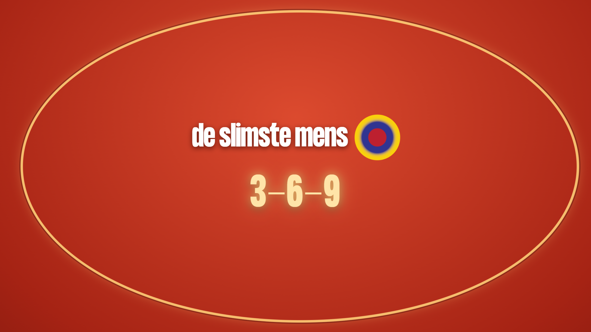 | 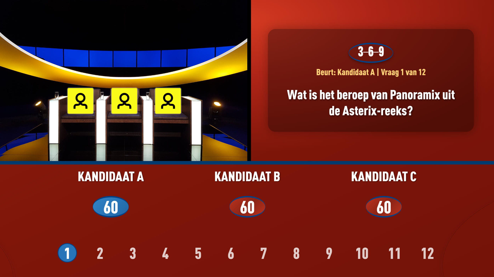 | 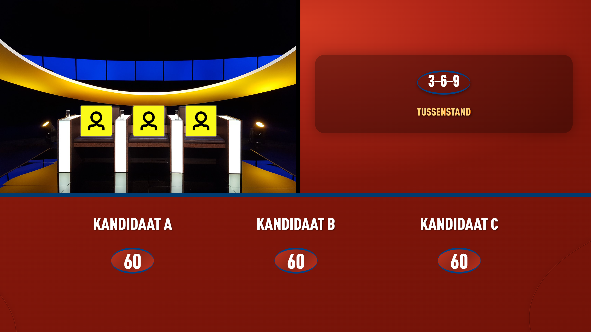 |
| 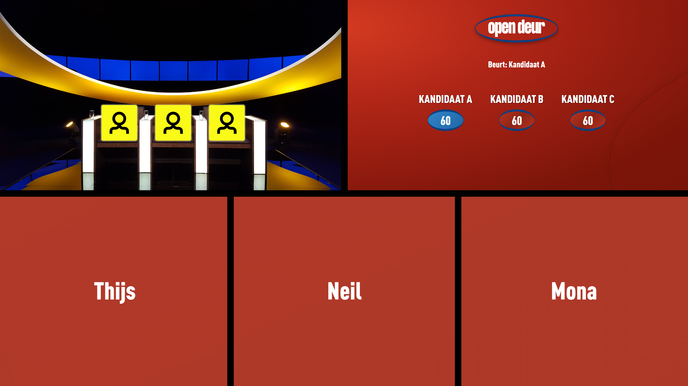 | 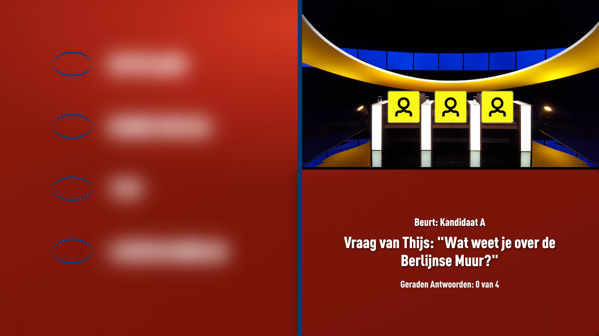 | 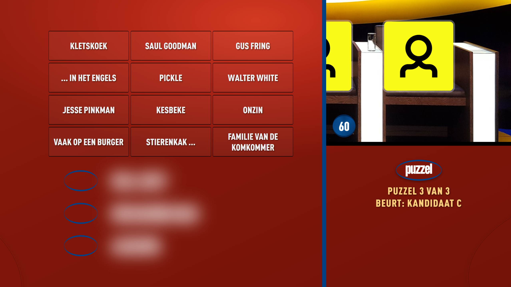 |
| 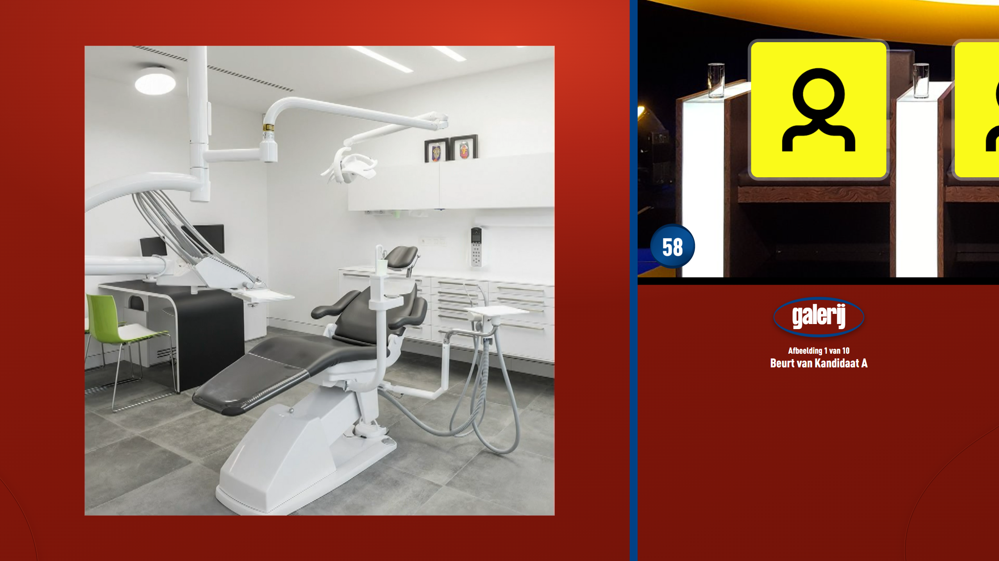 | 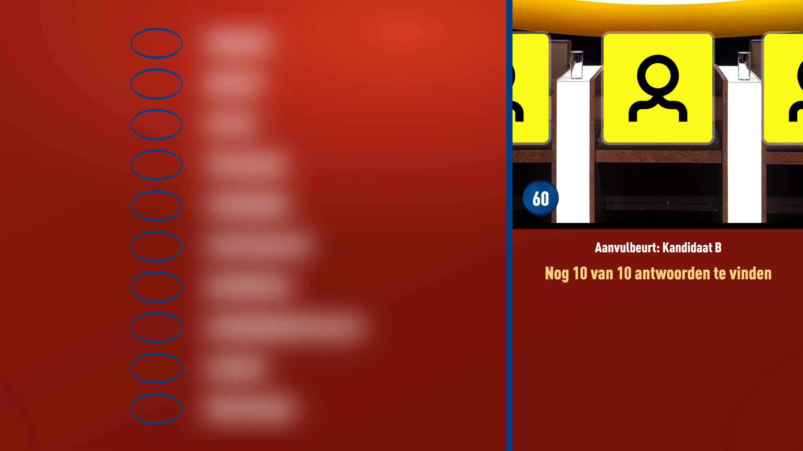 | 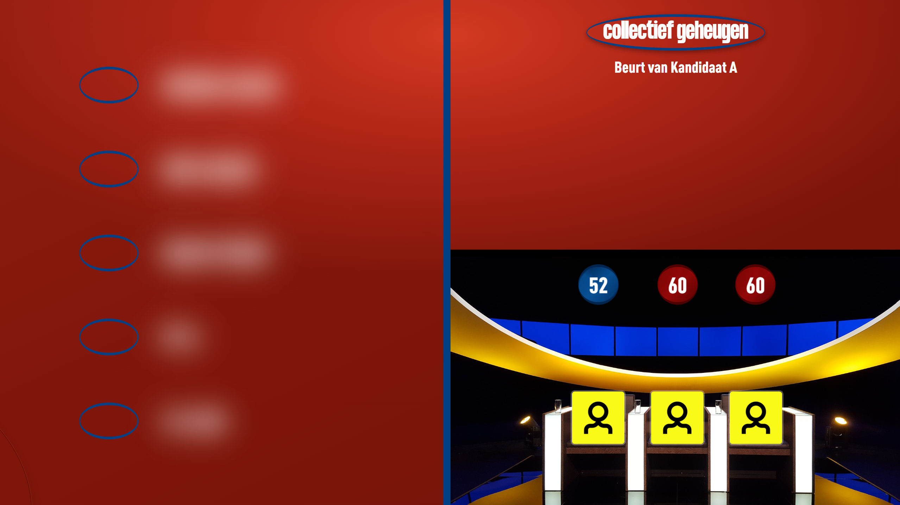 |
| 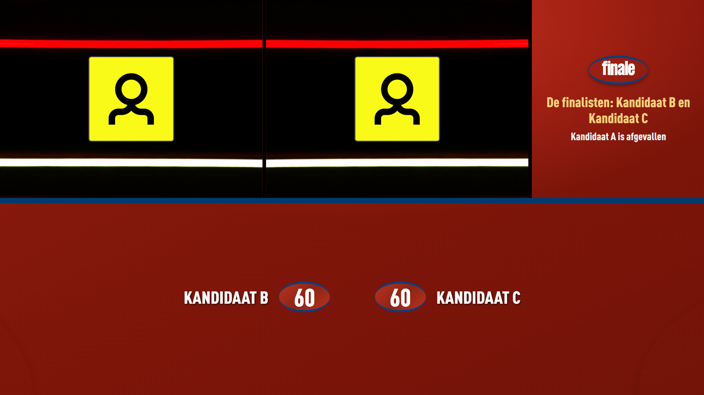 | 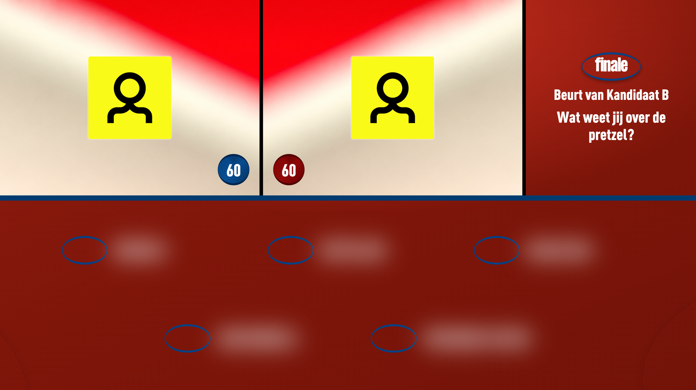 | 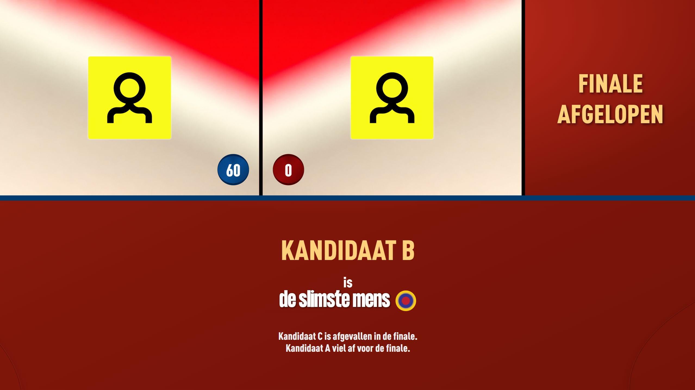 |